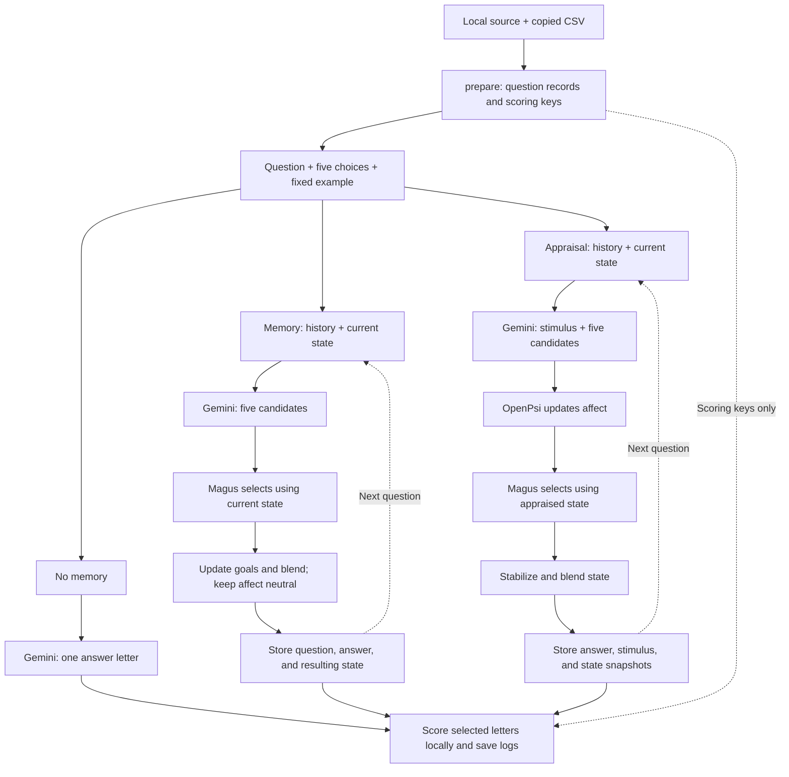

# Phase 1: STEU benchmark

Evaluate emotional understanding on 42 STEU questions using three configurations:

| Configuration | Processing |
| --- | --- |
| `no_memory` | Gemini selects a letter independently for each question. |
| `memory` | Gemini proposes candidates; Magus selects using history and state. Affect stays neutral. |
| `full_metamo` | Gemini proposes candidates and stimulus features; OpenPsi appraises before Magus selects. |

## Data

- [qpt6z-osfstorage-archive/](qpt6z-osfstorage-archive/) contains the three published experiment CSVs. Phase 1 uses `experiment_1_STEU.csv` for reference answers and scores.
- [data/steu_author_source.txt](data/steu_author_source.txt) supplies the questions, choices, and source scoring rules missing from that CSV.
- `data/steu_items.jsonl` contains the prepared questions and separate scoring keys; `data/steu_items.provenance.json` records their origin and file hashes.

`prepare` builds these records from local files without API calls. Run it once, then repeat only when the inputs or preparation logic change. `SOURCE_URL` records attribution; the code does not fetch it during preparation or execution. Answer keys and published explanations are excluded from prompts and memory.

## Run

From the repository root, configure `GEMINI_API_KEY` in `.env` or your environment, then:

```bash
# Prepare once and inspect the published reference results.
venv/bin/python -m benchmarks.phase1 prepare
venv/bin/python -m benchmarks.phase1 audit

# Check a two-item pilot, then run all 42 questions.
venv/bin/python -m benchmarks.phase1 run --limit 2
venv/bin/python -m benchmarks.phase1 run
```

The pilot requires six successful generations; the full run requires 126. Defaults are `gemini-3-flash-preview`, temperature `0`, and seed `42`; choose another available model with `--model MODEL_ID`.

## Processing flow

All configurations use the same fixed example. Gemini responses are validated before state or memory changes.



Gemini generates candidates before mathematical appraisal. The updated affect influences Magus's selection; there is no second Gemini planning call.

## Memory and response handling

Stateful conditions retain previous questions, choices, selected answers, and state snapshots in a Python list included in each new prompt. The appraisal condition also retains stimulus features and appraised states. Goals (`G`) can change in both conditions; affective modulators (`M`) change only with appraisal. Each condition and new run starts independently; previous logs are not automatically loaded as memory.

Protocol v2 uses a JSON schema, local validation, and a 16,384-token output limit. Up to three attempts handle transient service errors or invalid responses using unchanged prompts and settings. Rejected attempts do not advance memory or state; persistent failures stop the run.

## Code and offline tests

| File | Responsibility |
| --- | --- |
| [steu.py](steu.py) | Prepare, validate, load, and audit STEU data. |
| [phase1.py](phase1.py) | Build prompts, call Gemini, manage conditions, and save scores. |
| [tests/test_phase1.py](tests/test_phase1.py) | Check module bypasses, memory isolation, answer-key exclusion, parsing, and retries. |

Run all 12 protocol checks without Gemini API calls:

```bash
venv/bin/python -m unittest benchmarks.tests.test_phase1 -v
```

## Results

Each run creates a new directory under `benchmarks/results/runs/`:

| File | Contents |
| --- | --- |
| `manifest.json` | Settings, input hashes, item order, and completion status. |
| `responses.jsonl` | Prompts, answers, state changes, scores, and retry diagnostics. |
| `summary.json` | Accuracy by configuration after a complete run. |
| `failure.json` | Failed item and available response diagnostics, if a run stops. |

Scoring is provisional: `source_*` uses literal source SPSS rules; `reference_compatible_*` uses a CSV-compatible comparison key. The source rules disagree with some CSV scores and accept multiple answers for items 25 and 40. See the generated [reference audit](results/reference_audit.md).

The CSV's published totals are **24/42**, **31/42**, and **35/42**. These describe the [original GPT-3.5 prompting study](https://doi.org/10.1371/journal.pone.0301033), not this implementation's accuracy.

## Limitations

Finally, the current comparison has a practical limitation: the no-memory configuration asks Gemini directly for a letter, whereas the two stateful configurations generate candidates and use Magus. They can therefore differ even on their first question, when history is empty. The appraisal configuration also asks for additional stimulus features.

The results measure these **complete configurations**, including their prompting and decision paths. They do not yet isolate the effect of memory alone or the appraisal equations alone. The runner also uses the existing single-state appraisal–decision path; it does not invoke the research assistant’s dual-subsystem consensus.

Candidate goal correlations and updates are Gemini estimates; their mapping to emotional understanding is experimental. A two-item pilot verifies execution, and a single 42-item run does not establish reliable superiority.
