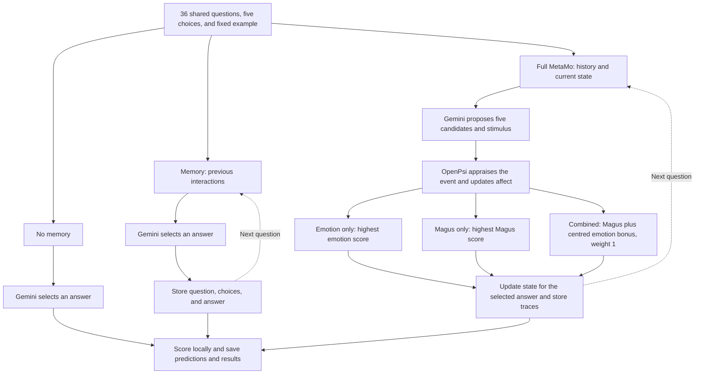

# Evaluation of MetaMo Appraisal and Emotional Understanding on the STEU Benchmark

This benchmark adapts Experiment 1 of Croissant et al.’s (2024) [An appraisal-based chain-of-emotion architecture for affective language model game agents](https://journals.plos.org/plosone/article?id=10.1371/journal.pone.0301033), which compared GPT-3.5 with no-memory, memory, and appraisal prompting on the Situational Test of Emotional Understanding (STEU). We intend to evaluate MetaMo’s appraisal component and emotion-informed decisions using nine ported OpenPsi feelings and 17 additional templates for emotions absent from the original feeling implementation.

## Question selection

**Six event-choice questions** were excluded from the primary comparison because their answer choices describe events rather than name emotions. The emotion-only selector matches each candidate emotion to a feeling score and cannot directly score event descriptions, so including these questions would disadvantage it and make comparisons unfair. All three systems and full-MetaMo selector variants therefore use the same **36 emotion-choice questions**, answer choices, and scoring keys. The excluded questions remain in the source dataset for separate evaluation and future extensions. 

## File responsibilities

| File | Responsibility |
| --- | --- |
| [steu_experiment.py](steu_experiment.py) | Build prompts, call Gemini, run conditions and selectors, save results, and resume interrupted runs. |
| [steu.py](steu.py) | Prepare questions and scoring keys, load items, and audit results. |
| [config.py](config.py) | Set the default selector and feeling weight; combined selection defaults to weight 1. |
| [extended_feelings.py](extended_feelings.py) | Define 17 additional emotions using the original fuzzy template format and scorer. |
| [OpenPsi feelings](../openpsi/feelings.py) | Preserve the nine original feeling definitions and fuzzy scoring functions. |
| [tests/test_steu_experiment.py](tests/test_steu_experiment.py) | Check the main functions and workflows offline. |
| [__init__.py](__init__.py) | Identify the benchmark package. |
| [steu_author_source.txt](data/steu_author_source.txt) | Supply the author-provided questions, choices, and source scoring rules. |
| [Experiment 1 CSV](qpt6z-osfstorage-archive/experiment_1_STEU.csv) | Preserve the paper’s published predictions and scores for reference. |
| [Experiment 2 CSV](qpt6z-osfstorage-archive/experiment_2_LIWC_Output.csv), [Experiment 3 CSV](qpt6z-osfstorage-archive/experiment_3_user_study.csv) | Retain published data from the paper’s later experiments. |

You can change SELECTOR and FEELING_WEIGHT in [config.py](config.py) to further experiment with the implementation. These values set the defaults for new runs; resumed runs retain their saved settings.

Each new manifest includes a snapshot of every public constant in [config.py](config.py) and [core/config.py](../core/config.py). Effective selector and weight overrides remain recorded separately; resume history records the configuration at each continuation.

## Processing flow

Each condition starts independently. Memory includes all previous questions, choices, and generated answers; full-MetaMo also retains numerical state and appraisal traces.

## Reproduce the comparison

1. **Set up once:** create an environment, install dependencies, and copy the environment template if needed. Set GEMINI_API_KEY and GEMINI_MODEL in the project .env file before running live experiments.

2. **Prepare once:** use the prepare operation in steu_experiment.py to generate the question records, separate scoring keys, and provenance hashes from the local source files.
3. **Run the primary comparison:** use the run operation with the emotion-items-only filter for all three conditions, keeping the same model, question order, temperature 0, seed 42, and combined feeling weight 1.
4. **Compare selectors:** select only full_metamo and run emotion_only, magus_only, and magus_with_emotion separately on the same questions; reuse the primary combined run when its settings match.
5. **Audit each completed run:** use audit-experiment on its saved folder. Results under benchmarks/results/runs include settings and exclusions in manifest.json, predictions and decision traces in responses.jsonl, accuracy under both scoring keys in summary.json, and detailed JSON/Markdown audit reports; resume interrupted runs before auditing them.
