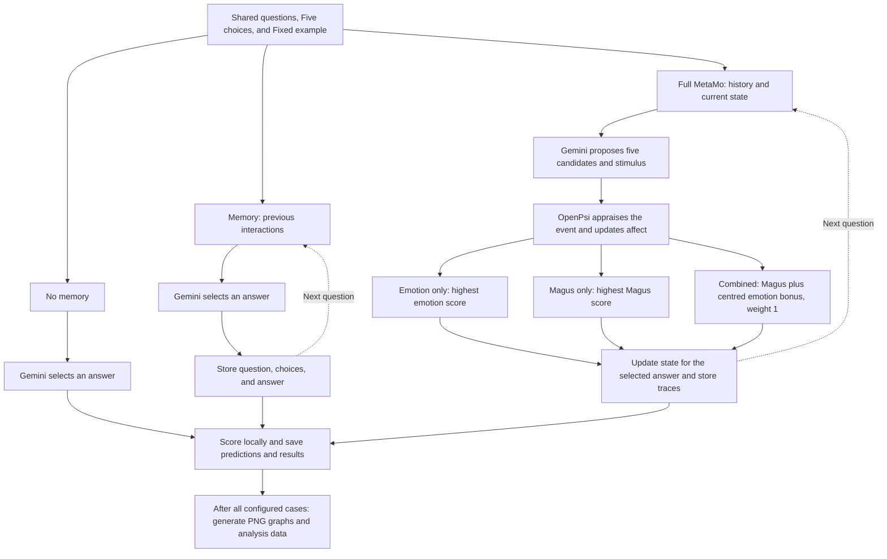

# Evaluation of MetaMo Appraisal and Emotional Understanding on the STEU Benchmark

This benchmark adapts Experiment 1 of Croissant et al.’s (2024) [An appraisal-based chain-of-emotion architecture for affective language model game agents](https://journals.plos.org/plosone/article?id=10.1371/journal.pone.0301033), which compared GPT-3.5 with no-memory, memory, and appraisal prompting on the Situational Test of Emotional Understanding (STEU). We intend to evaluate MetaMo’s appraisal component and emotion-informed decisions using nine ported OpenPsi feelings and 17 additional templates for emotions absent from the original feeling implementation.

## Question selection

**Six event-choice questions** were excluded from the primary comparison because their answer choices describe events rather than name emotions. The emotion-only selector matches each candidate emotion to a feeling score and cannot directly score event descriptions, so including these questions would disadvantage it and make comparisons unfair. All three systems and full-MetaMo selector variants therefore use the same **36 emotion-choice questions**, answer choices, and scoring keys. The excluded questions remain in the source dataset for separate evaluation and future extensions. 

## File responsibilities

| File | Responsibility |
| --- | --- |
| [steu_experiment.py](steu_experiment.py) | Prepare questions, run configured cases, save results, generate graphs, and resume interrupted experiments. |
| [helpers.py](helpers.py) | Build prompts, validate replies, resolve emotion labels, and handle Gemini requests and retries. |
| [steu_data.py](steu_data.py) | Prepare questions and scoring keys, load items, and validate saved results. |
| [generate_plots.py](generate_plots.py) | Validate saved runs and generate PNG comparison graphs, JSON metrics, and question-level CSV data offline. |
| [config.py](config.py) | Configure the feeling weight, supported and selected selectors, selector comparison, and experimental conditions. |
| [extended_feelings.py](extended_feelings.py) | Define 17 additional emotions using the original fuzzy template format and scorer. |
| [OpenPsi feelings](../openpsi/feelings.py) | Preserve the nine original feeling definitions and fuzzy scoring functions. |
| [tests/test_steu_experiment.py](tests/test_steu_experiment.py) | Check the main functions and workflows offline. |
| [__init__.py](__init__.py) | Identify the benchmark package. |
| [steu_author_source.txt](data/steu_author_source.txt) | Supply the author-provided questions, choices, and source scoring rules. |
| [Experiment 1 CSV](qpt6z-osfstorage-archive/experiment_1_STEU.csv) | Preserve the paper’s published predictions and scores for reference. |
| [Experiment 2 CSV](qpt6z-osfstorage-archive/experiment_2_LIWC_Output.csv), [Experiment 3 CSV](qpt6z-osfstorage-archive/experiment_3_user_study.csv) | Retain published data from the paper’s later experiments. |

Change settings in [config.py](config.py) to experiment with the implementation. COMPARE_SELECTORS=True evaluates all three MetaMo selectors; False uses only SELECTOR. CONDITIONS independently controls which systems run, including the baselines. FEELING_WEIGHT controls combined selection and defaults to 1.0. CONDITIONS selects the systems to evaluate. Execution defaults live in steu_experiment.py; Gemini request limits and retries live in helpers.py. The model comes from GEMINI_MODEL in .env.

Each experiment and run saves benchmark and core configuration constants, effective selector settings, question IDs, and dataset fingerprints. Code fingerprints cover both the runner and helper module. Resumed experiments retain their saved settings.

## Processing flow

Each condition starts independently. Memory includes all previous questions, choices, and generated answers; full-MetaMo also retains numerical state and appraisal traces.



## Reproduce the comparison

Run without subcommands or experiment flags; choose conditions and selectors in [config.py](config.py).

1. **Set up once:** activate your Python environment, install dependencies with `python -m pip install -r requirements.txt`, and set GEMINI_API_KEY and GEMINI_MODEL in .env.
2. **Configure:** in [config.py](config.py), include no_memory, memory, and full_metamo in CONDITIONS, set COMPARE_SELECTORS=True, and keep FEELING_WEIGHT=1.0 for the full five-case comparison.
3. **Run from the repository root:**

   ```bash
   python -m benchmarks.steu_experiment
   ```

Questions are prepared and PNG graphs generated automatically. Settings, predictions, scores, and PNG/JSON/CSV analysis are saved under **benchmarks/results/&lt;timestamp&gt;/**.

For a fresh experiment, keep RESUME_DIRECTORY=None in steu_experiment.py. To resume an interrupted experiment, set it to the saved folder and run the same command.
