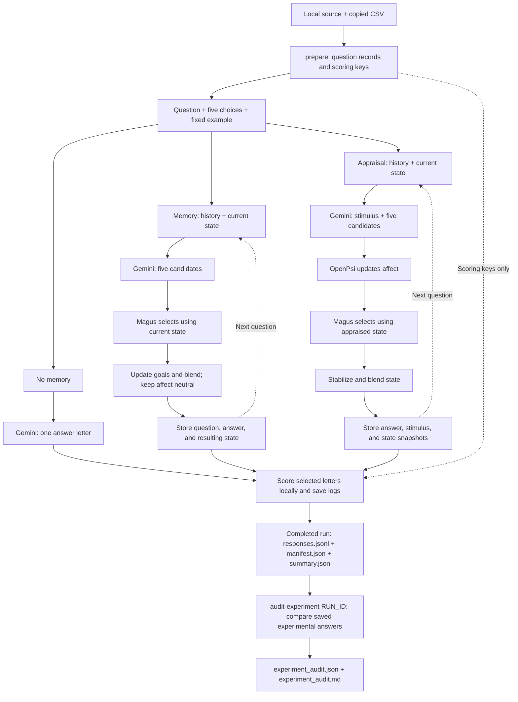

# Phase 1: STEU benchmark

Evaluate emotional understanding on 42 STEU questions using three configurations:

| Configuration | Processing |
| --- | --- |
| `no_memory` | Gemini selects a letter independently for each question. |
| `memory` | Gemini proposes candidates; Magus selects using history and state. Affect stays neutral. |
| `full_metamo` | Gemini proposes candidates and stimulus features; OpenPsi appraises before Magus selects. |

## Data

- [qpt6z-osfstorage-archive/](qpt6z-osfstorage-archive/) contains the three published experiment CSVs. Phase 1 uses `experiment_1_STEU.csv` for reference answers and scores.
- [data/steu_author_source.txt](data/steu_author_source.txt) supplies the questions, choices, and source scoring rules missing from that CSV.
- `data/steu_items.jsonl` contains the prepared questions and separate scoring keys; `data/steu_items.provenance.json` records their origin and file hashes. Both are generated by `prepare` and ignored by Git; the source text and original CSVs remain versioned.

`prepare` builds these records from local files without API calls. Run it once, then repeat only when the inputs or preparation logic change. `SOURCE_URL` records attribution; the code does not fetch it during preparation or execution. Answer keys and published explanations are excluded from prompts and memory.

`source_answers` follows the SPSS rules in the local ResearchGate source. `reference_answers` is a provisional CSV-compatible key: it uses positively scored CSV answers, or source answers consistent with the CSV's incorrect responses when none was scored correct. Neither field contains a new model prediction. These keys differ from the original publisher key at some items.

## Run

From the repository root, configure `GEMINI_API_KEY` in `.env` or your environment. The experimental workflow is **prepare → run → audit-experiment**:

```bash
# 1. Prepare the dataset once.
venv/bin/python -m benchmarks.phase1 prepare

# 2. Run your experiment on all 42 questions.
venv/bin/python -m benchmarks.phase1 run

# 3. Audit YOUR saved results; replace RUN_ID with the folder printed by run.
venv/bin/python -m benchmarks.phase1 audit-experiment benchmarks/results/runs/RUN_ID
```

`audit-experiment` makes no API calls and saves `experiment_audit.json` and `experiment_audit.md` in the selected run folder. It validates the completed response set, checks the prepared dataset against the run's hash, and verifies saved correctness flags. Use `--items PATH` for the original prepared dataset if its location differs, or `--output DIRECTORY` to save reports elsewhere. It does not repeat the experiment or modify its responses, manifest, or summary. Resume an interrupted run before auditing it.

For an optional two-question pilot, use `venv/bin/python -m benchmarks.phase1 run --limit 2`, then audit its printed run folder. Pilot audits are labeled as partial and do not represent a full STEU score.

The separate command below checks the **paper's published CSV**, not your experimental results. It can run before or after your experiment and is not required for the workflow above:

```bash
venv/bin/python -m benchmarks.phase1 audit
```

The pilot requires six successful generations; the full run requires 126. The model is read from `GEMINI_MODEL` after loading `.env`, with `gemini-3.1-flash-lite` as the fallback. Use `--model MODEL_ID` to override it. Temperature defaults to `0` and seed to `42`.

Continue an interrupted run without repeating completed questions:

```bash
venv/bin/python -m benchmarks.phase1 run --resume benchmarks/results/runs/RUN_ID --request-interval 6
```

Resume restores the saved model, temperature, seed, question order, history, and numerical states. It checks dataset hashes and saved prompts before appending pending responses. Changed settings or incompatible records are rejected; earlier failure reports are archived. `--request-interval` optionally spaces item requests by at least the specified number of seconds.

## Processing flow

All configurations use the same fixed example. Gemini responses are validated before state or memory changes.



Gemini generates candidates before mathematical appraisal. The updated affect influences Magus's selection; there is no second Gemini planning call.

## Memory and response handling

Stateful conditions retain previous questions, choices, selected answers, and state snapshots in a Python list included in each new prompt. The appraisal condition also retains stimulus features and appraised states. Goals (`G`) can change in both conditions; affective modulators (`M`) change only with appraisal. Each condition and new run starts independently; `--resume` explicitly restores a saved run's history and state.

Protocol v2 uses a JSON schema, local validation, and a 16,384-token output limit. Up to three attempts handle transient service errors or invalid responses using unchanged prompts and settings. Rejected attempts do not advance memory or state; persistent failures stop the run.

HTTP 429 means a rate-limit or quota failure. Retries honor API wait hints; otherwise they wait 30 and 60 seconds. API messages and quota details are saved in `failure.json`. Daily-quota errors or retry hints exceeding two minutes stop promptly so the run can be resumed later. Pacing and retries cannot increase your [Gemini quota](https://ai.google.dev/gemini-api/docs/rate-limits).

## Code and offline tests

| File | Responsibility |
| --- | --- |
| [steu.py](steu.py) | Prepare and load STEU data; audit published and experimental results with shared scoring comparisons. |
| [phase1.py](phase1.py) | Build prompts, call Gemini, manage conditions, and save scores. |
| [tests/test_phase1.py](tests/test_phase1.py) | Check module bypasses, memory isolation, answer-key exclusion, parsing, and retries. |

Run the offline protocol checks without Gemini API calls:

```bash
venv/bin/python -m unittest benchmarks.tests.test_phase1 -v
```

## Results

Each run creates a new directory under `benchmarks/results/runs/`:

| File | Contents |
| --- | --- |
| `manifest.json` | Settings, input hashes, item order, and completion status. |
| `responses.jsonl` | Prompts, answers, state changes, scores, and retry diagnostics. |
| `summary.json` | Accuracy by configuration after a complete run. |
| `experiment_audit.json` / `.md` | Detailed experimental comparisons generated by `audit-experiment`. |
| `failure.json` | Failed item and available response diagnostics, if a run stops. |

The experimental audit reports accuracy and incorrect question IDs for each configuration under **both** scoring keys. Its `paired_changes` compare `memory_vs_no_memory`, `full_metamo_vs_memory`, and `full_metamo_vs_no_memory`:

- `improved_ids`: the earlier configuration was wrong and the compared configuration was correct (0 → 1).
- `regressed_ids`: the earlier configuration was correct and the compared configuration was wrong (1 → 0).
- `unchanged_correct_ids` / `unchanged_incorrect_ids`: both configurations had the same correctness outcome.
- `net_correct_change`: number improved minus number regressed.

Scoring is provisional: `source_*` uses literal source SPSS rules; `reference_compatible_*` uses a CSV-compatible comparison key. The source rules disagree with some CSV scores and accept multiple answers for items 25 and 40. See the generated [reference audit](results/reference_audit.md).

The CSV's published totals are **24/42**, **31/42**, and **35/42**. These describe the [original GPT-3.5 prompting study](https://doi.org/10.1371/journal.pone.0301033), not this implementation's accuracy.

## Limitations

Finally, the current comparison has a practical limitation: the no-memory configuration asks Gemini directly for a letter, whereas the two stateful configurations generate candidates and use Magus. They can therefore differ even on their first question, when history is empty. The appraisal configuration also asks for additional stimulus features.

The results measure these **complete configurations**, including their prompting and decision paths. They do not yet isolate the effect of memory alone or the appraisal equations alone. The runner also uses the existing single-state appraisal–decision path; it does not invoke the research assistant’s dual-subsystem consensus.

Candidate goal correlations and updates are Gemini estimates; their mapping to emotional understanding is experimental. A two-item pilot verifies execution, and a single 42-item run does not establish reliable superiority.
